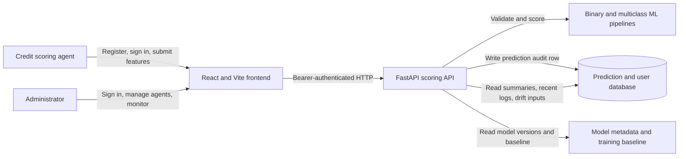
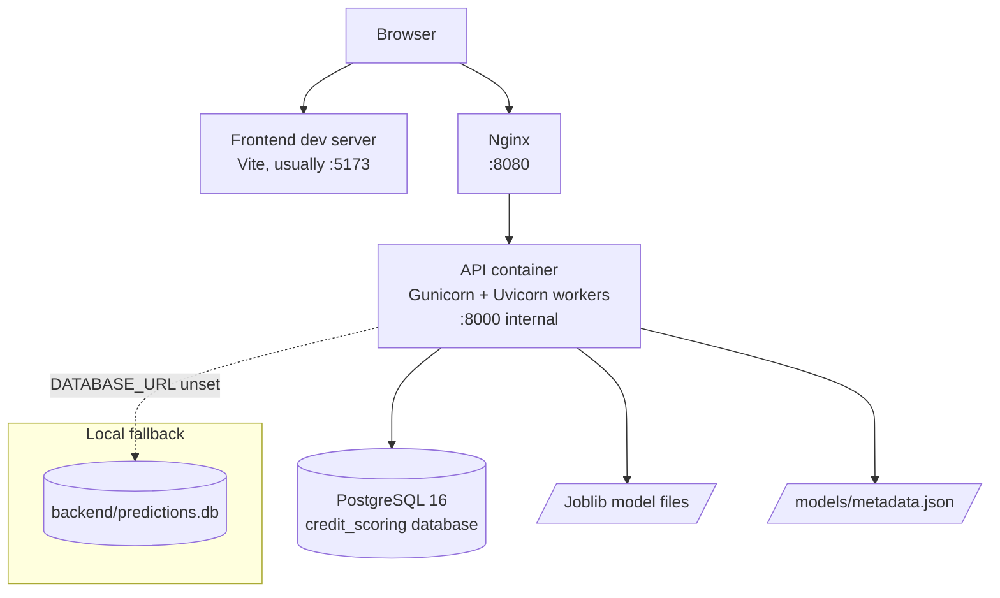
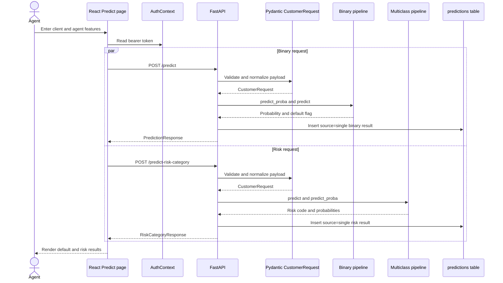
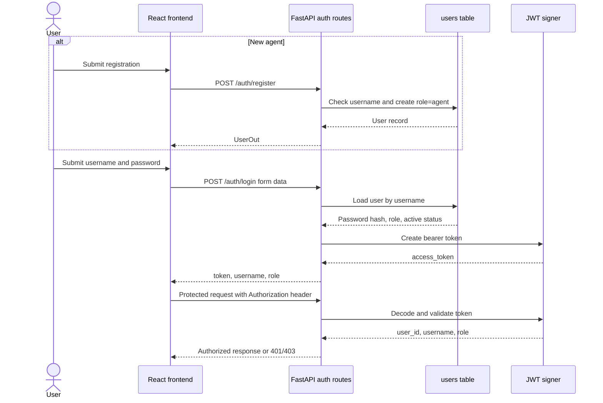
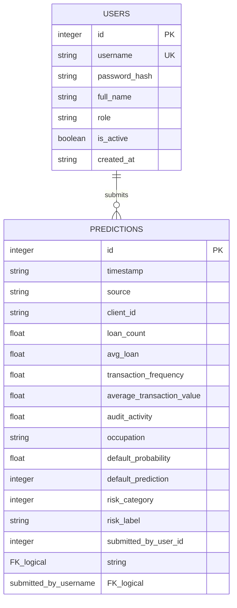
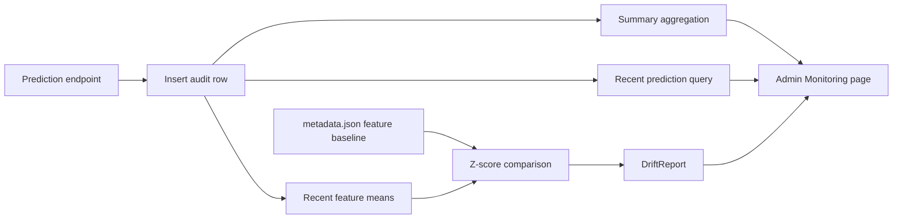
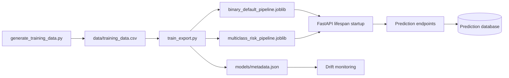
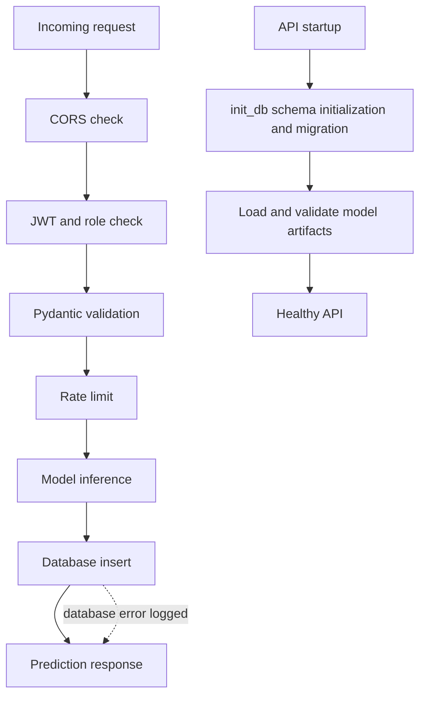

# Agent Credit Scoring System Architecture

This document describes the system implemented in this repository. Mermaid diagrams are rendered by GitHub, VS Code Markdown preview extensions, and most modern documentation tools.

## Editable System Drawing

- [system-architecture.drawio](system-architecture.drawio) contains the editable diagrams.net system drawing.
- [system-architecture.svg](system-architecture.svg) is a standalone preview of the drawing.

Open the `.drawio` file in [diagrams.net](https://app.diagrams.net/) or import it into a compatible diagram editor.

## 1. System Context

The system scores mobile money agents using two trained scikit-learn pipelines. Agents submit feature data through the React application. Administrators review prediction history, aggregate risk statistics, and feature drift.



## 2. Container and Deployment Diagram

Local development uses SQLite when `DATABASE_URL` is unset. The supplied Docker Compose deployment uses PostgreSQL, the API container, and Nginx.



### Runtime responsibilities

| Container or module | Responsibility |
| --- | --- |
| React frontend | Login, registration, prediction form, agent workspace, admin monitoring, account and session management |
| Nginx | Reverse proxy and public entry point for Compose deployment |
| FastAPI app | Auth, validation, rate limiting, model inference, agent workspace, governance, logging, monitoring endpoints |
| `db.py` | SQLite/PostgreSQL connection abstraction, schema initialization, prediction/user queries |
| Joblib artifacts | Binary default model and multiclass risk model |
| `metadata.json` | Training feature baseline, model metrics, and training timestamp |
| PostgreSQL or SQLite | Durable predictions, users, sessions, audit, drift history, deployment history, and agent profile data |

## 3. Frontend Route Diagram

```mermaid
flowchart TD
    Root[/]
    Register[/register]
    Console[/console]
    Predict[/console/predict]
    Workspace[/console/workspace]
    Monitoring[/console/monitoring]
    Agents[/console/agents]
    Admin[/admin]

    Root -->|Register| Register
    Root -->|Authenticated user| Console
    Admin -->|Redirect| Monitoring
    Console --> Predict
    Console -->|admin role| Monitoring
    Console -->|admin role| Agents
    Console -->|agent role| Predict
    Console -->|agent role| Workspace
```

All console routes are protected by `ProtectedRoute`. Monitoring and agent management additionally require the `admin` role.

## 4. Prediction Request Sequence

The current prediction page sends two requests for one form submission: one for binary default risk and one for multiclass risk category. Each endpoint writes one audit row, so a single UI submission produces two related `predictions` rows with complementary output fields.



### Prediction endpoints

| Method and route | Role | Purpose | Log source |
| --- | --- | --- | --- |
| `POST /predict` | agent or admin | Binary default probability and flag | `single` |
| `POST /predict-risk-category` | agent or admin | Four-class risk category | `single` |
| `POST /predict/batch` | agent or admin | Up to 5,000 binary predictions | `batch` |
| `POST /predict-risk-category/batch` | agent or admin | Up to 5,000 risk classifications | `batch` |

## 5. Authentication and Authorization Flow



Admin accounts are seeded from server environment configuration at startup. Self-registration always creates an agent account.

## 6. Database Schema / ERD

The application supports the following logical schema. The `submitted_by_*` columns are attribution fields; the current implementation does not create a database foreign key between `predictions.submitted_by_user_id` and `users.id`.



### `users`

| Column | Type | Constraints / meaning |
| --- | --- | --- |
| `id` | integer / serial | Primary key |
| `username` | text | Required and unique |
| `password_hash` | text | Bcrypt password hash; never return to clients |
| `full_name` | text | Optional display name |
| `role` | text | `agent` or `admin` |
| `is_active` | boolean/integer | Account status |
| `created_at` | text/timestamp | Account creation time |

### `predictions`

| Column | Type | Constraints / meaning |
| --- | --- | --- |
| `id` | integer / bigserial | Primary key |
| `timestamp` | text/timestamp | UTC insert time |
| `source` | text | `single`, `batch`, or `csv` |
| `client_id` | text | Optional client identifier |
| `loan_count` | numeric | Input feature |
| `avg_loan` | numeric | Input feature |
| `transaction_frequency` | numeric | Input feature |
| `average_transaction_value` | numeric | Input feature |
| `audit_activity` | numeric | Input feature |
| `occupation` | text | Input feature |
| `default_probability` | numeric | Binary model output; nullable for risk-only row |
| `default_prediction` | integer | Binary model flag; nullable for risk-only row |
| `risk_category` | integer | 0 to 3; nullable for binary-only row |
| `risk_label` | text | Human-readable risk tier |
| `submitted_by_user_id` | integer | Authenticated submitter id; nullable for legacy rows |
| `submitted_by_username` | text | Authenticated submitter name; nullable for legacy rows |

## 7. Monitoring and Drift Detection



The admin monitoring page calls:

- `GET /api/logs/summary` for total predictions, risk-tier counts, and average default probability.
- `GET /api/logs/recent?limit=10` for the latest audit rows.
- `GET /api/logs/drift` for feature means compared with the training baseline.
- `GET /api/logs/drift-history` and `/api/alerts` for persisted drift checks and current warnings.
- `/api/model-deployments` for startup and reload history.
- `/api/audit-events` for administrator actions.

For a feature $x$, the drift score is calculated as:

$$
z_x = \frac{\bar{x}_{recent} - \mu_{training}}{\sigma_{training} + 10^{-8}}
$$

A feature is flagged when $|z_x| > 2$.

## 8. Model Training and Serving Lifecycle



At API startup, both joblib pipelines are loaded and validated. The API records a short file hash as the model version returned in prediction responses. `/admin/reload-models` can reload both artifacts when a configured `X-API-Key` is supplied.

## 9. Operational Boundaries and Failure Points



Prediction logging is intentionally best-effort in the current implementation: a database logging exception is logged by the API and does not fail the prediction response. Database availability and schema migration should therefore be checked during startup and monitored through application logs.

## 10. Source-of-Truth Files

For expanded ERDs, table-level diagrams, column definitions, indexes, and migration details, see [database-schema.md](database-schema.md).

| Concern | File |
| --- | --- |
| API routes and model lifecycle | `backend/app.py` |
| Database connection, migrations, and queries | `backend/db.py` |
| Request and response schemas | `backend/schemas.py` |
| Authentication and JWT | `backend/auth.py` |
| PostgreSQL bootstrap schema | `backend/postgresql/init.sql` |
| Compose deployment | `backend/docker-compose.yml` |
| Frontend route tree | `Frontend/src/App.jsx` |
| Prediction UI | `Frontend/src/pages/Predict.jsx` |
| Agent workspace UI | `Frontend/src/pages/AgentWorkspace.jsx` |
| Admin monitoring UI | `Frontend/src/pages/Monitoring.jsx` |
| Admin account/session UI | `Frontend/src/pages/Agents.jsx` |
