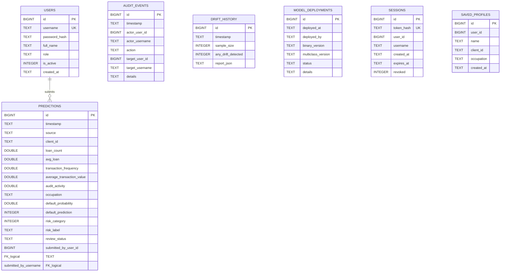
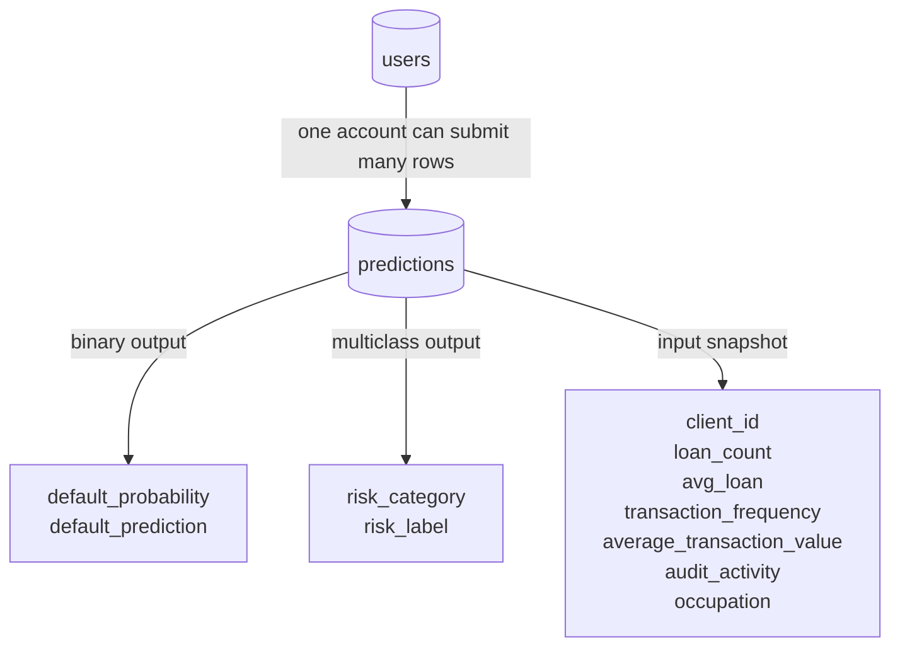
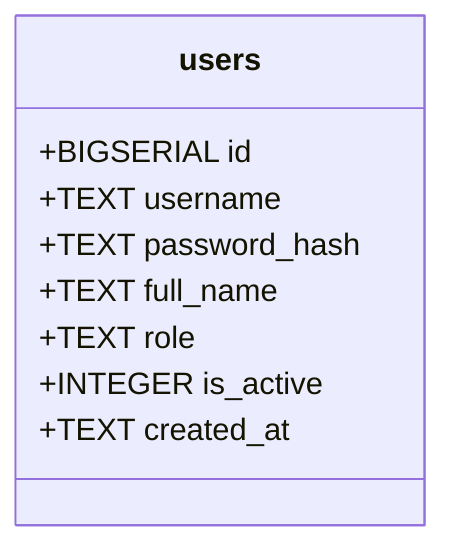
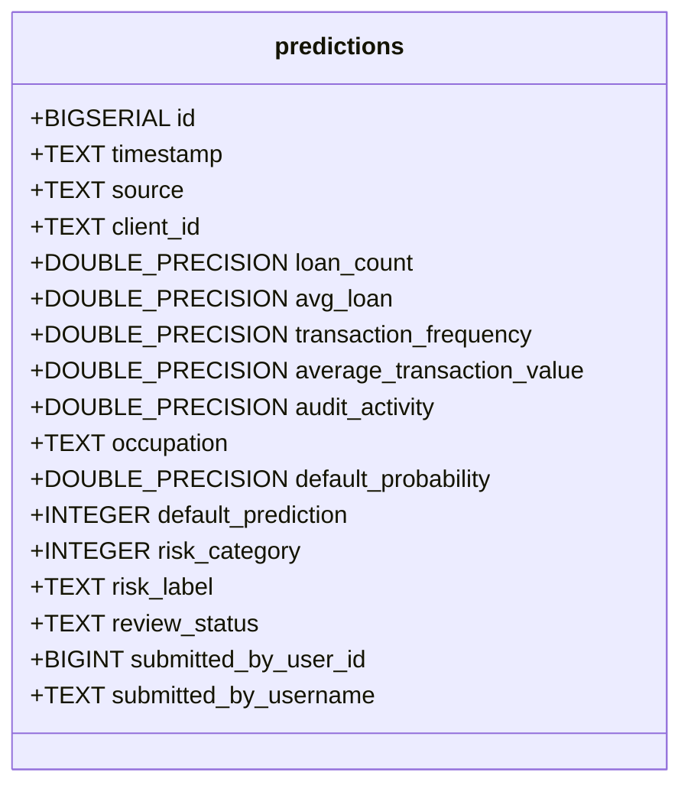
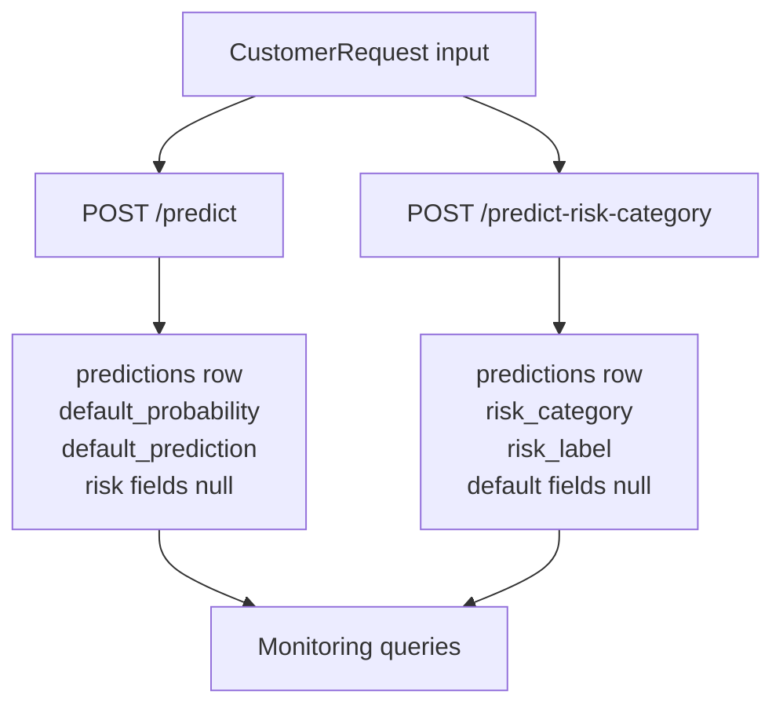
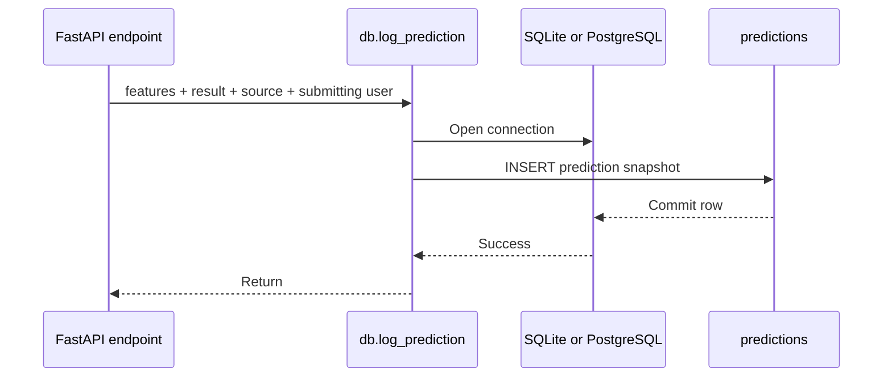
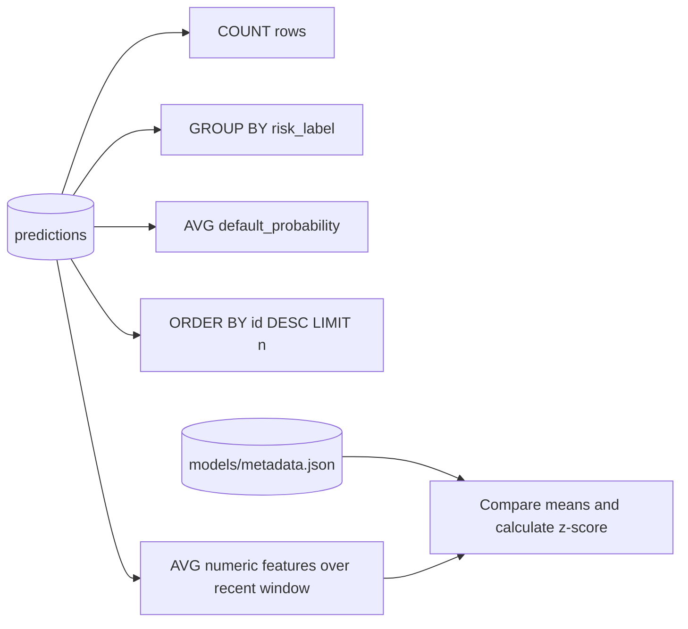
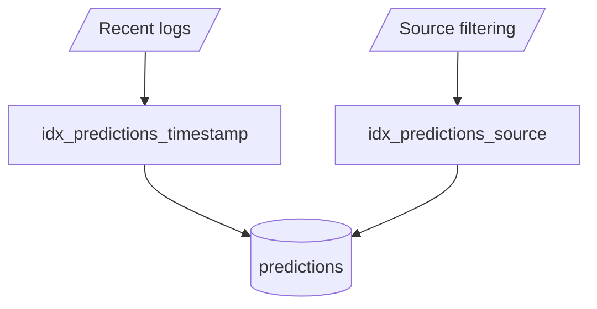
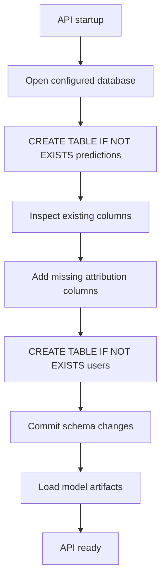

# Database Schema Diagrams

This document describes the persistence model used by the credit scoring API. The database layer supports SQLite for local development and PostgreSQL for the Docker deployment.

## Editable Drawings

- [database-erd.drawio](database-erd.drawio) contains editable diagrams.net pages for the logical ERD and physical schema.
- [database-erd.svg](database-erd.svg) is a standalone preview of the logical ERD.

Open the `.drawio` file in [diagrams.net](https://app.diagrams.net/) or import it into a compatible diagram editor.

## 1. Entity Relationship Diagram

`predictions.submitted_by_user_id` and `predictions.submitted_by_username` identify the submitting account. They are logical relationships in the current application; the database does not enforce a foreign key constraint.



## 2. Relational Schema Overview



## 3. `users` Table



| Column | PostgreSQL | SQLite | Nullability | Meaning |
| --- | --- | --- | --- | --- |
| `id` | `BIGSERIAL` | `INTEGER PRIMARY KEY AUTOINCREMENT` | no | Account identifier |
| `username` | `TEXT UNIQUE` | `TEXT UNIQUE` | no | Login name |
| `password_hash` | `TEXT` | `TEXT` | no | Bcrypt password hash |
| `full_name` | `TEXT` | `TEXT` | yes | Optional display name |
| `role` | `TEXT` | `TEXT` | no | `agent` or `admin` |
| `is_active` | `INTEGER` | `INTEGER` | no | `1` active, `0` disabled |
| `created_at` | `TEXT` | `TEXT` | no | UTC creation timestamp |

## 4. `predictions` Table



| Column | PostgreSQL | SQLite | Nullability | Meaning |
| --- | --- | --- | --- | --- |
| `id` | `BIGSERIAL` | `INTEGER PRIMARY KEY AUTOINCREMENT` | no | Prediction row identifier |
| `timestamp` | `TEXT` | `TEXT` | no | UTC time of insertion |
| `source` | `TEXT` | `TEXT` | no | `single`, `batch`, or `csv` |
| `client_id` | `TEXT` | `TEXT` | yes | Optional external client identifier |
| `loan_count` | `DOUBLE PRECISION` | `REAL` | yes | Number of loans |
| `avg_loan` | `DOUBLE PRECISION` | `REAL` | yes | Average loan value |
| `transaction_frequency` | `DOUBLE PRECISION` | `REAL` | yes | Transaction count/frequency |
| `average_transaction_value` | `DOUBLE PRECISION` | `REAL` | yes | Average transaction value |
| `audit_activity` | `DOUBLE PRECISION` | `REAL` | yes | Audit activity count |
| `occupation` | `TEXT` | `TEXT` | yes | Agent occupation |
| `default_probability` | `DOUBLE PRECISION` | `REAL` | yes | Binary model probability |
| `default_prediction` | `INTEGER` | `INTEGER` | yes | Binary model flag, `0` or `1` |
| `risk_category` | `INTEGER` | `INTEGER` | yes | Multiclass code, `0` to `3` |
| `risk_label` | `TEXT` | `TEXT` | yes | `LOW RISK`, `MEDIUM RISK`, `HIGH RISK`, or `VERY HIGH RISK` |
| `review_status` | `TEXT` | `TEXT` | no | Agent follow-up status |
| `submitted_by_user_id` | `BIGINT` | `INTEGER` | yes | Authenticated submitter id |
| `submitted_by_username` | `TEXT` | `TEXT` | yes | Authenticated submitter name |

## 5. Prediction Row Lifecycle

One form submission from the prediction page calls both model endpoints. This creates two rows for the same input snapshot: one binary result row and one risk-category result row.



## 6. Database Write Sequence



The current endpoint behavior treats logging as best effort. If an insert fails, the API logs the exception and still returns the model prediction. Startup schema initialization and application logs should therefore be monitored for persistence failures.

## 7. Monitoring Query Model



| API query | Database operation | Dashboard use |
| --- | --- | --- |
| `/api/logs/summary` | `COUNT`, `GROUP BY risk_label`, `AVG` | Total, tiers, average default probability |
| `/api/logs/recent` | Latest rows ordered by `id` | Recent predictions table |
| `/api/logs/drift` | Recent feature means plus baseline comparison | Drift status and alert |

## 8. Indexes and Access Paths



The PostgreSQL bootstrap script creates:

```sql
CREATE INDEX idx_predictions_timestamp
    ON predictions (timestamp DESC);

CREATE INDEX idx_predictions_source
    ON predictions (source);
```

SQLite uses the same logical table and query patterns. Its database file is `backend/predictions.db` unless `PREDICTIONS_DB_PATH` changes the location.

## 9. Schema Initialization and Migration



This allows an older SQLite or PostgreSQL database to gain the attribution columns without deleting existing prediction history. New deployments should use [backend/postgresql/init.sql](../backend/postgresql/init.sql), while [backend/db.py](../backend/db.py) remains the runtime source of schema initialization and migration behavior.

## 10. Consistency Notes

- `predictions` stores an input snapshot so historical results remain auditable even if a client changes later.
- A single UI submission creates two complementary rows because binary and multiclass scoring are separate API calls.
- Legacy rows may have null submitter fields because attribution was added after the original table was created.
- The current schema records the user relationship by values, but does not enforce a database foreign key. This prevents deleting or renaming a user from breaking historical logs, but allows orphaned ids if data is edited directly.
- `audit_events` records status changes, password resets, role changes, and session revocations.
- `drift_history` stores each drift report for history charts and alerts.
- `model_deployments` stores startup and model-reload versions.
- `sessions` stores token hashes, expiry, and revocation state; raw tokens are not stored.
- `saved_profiles` remains supported by the database layer but is not exposed in the current agent console.
